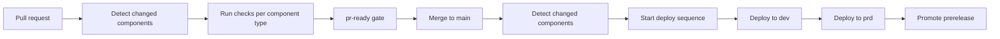

# slingshot-pipelines

slingshot-pipelines is a set of reusable **GitHub Actions workflows and actions** that give a repository a consistent CI/CD pipeline without copy-pasting hundreds of lines of YAML.

You describe *what* is in your repository (projects, components, environments) in small `info.yml` files, and the pipelines figure out *what changed*, *what to check*, and *where to deploy*.

:::note[Status of these docs]
These docs are a first draft. Parts of the reference are inferred from how real repositories consume slingshot-pipelines (see the [rx-refill-reminders example](./examples/rx-refill-reminders.md)) and are marked as such. If you find something that doesn't match the source, please open an issue or PR.
:::

## The pieces

| Piece | What it is | Where it lives |
|-------|------------|----------------|
| **Project** | The repository as a whole, plus its environments and deployment order | `.components/info.yml` |
| **Component** | A deployable or checkable unit inside the project (e.g. a Terragrunt infrastructure root) | `.components/<name>/info.yml` |
| **Reusable workflows** | Full pipelines (check, deploy, ...) that your workflows call with `uses:` | `slingshot-pipelines/workflows` |
| **Actions** | Small building blocks (detect changes, parse the deployment sequence, ...) | `slingshot-pipelines/action-*` |
| **Schemas** | JSON Schemas for editor validation of `info.yml` files | `slingshot-pipelines/jsonschemas` |

## How a change flows through

1. On a **pull request**, only the components that changed are checked, and a single `pr-ready` job summarises the result so it can be the one required status check.
2. On **merge to main**, changed components start a **deployment sequence**.
3. Each environment in the sequence is deployed in turn; when a deploy succeeds, the next environment is triggered with a `repository_dispatch` event.
4. When the last environment succeeds, the prerelease is promoted to a release.

## Where to go next

- New here? Read [Concepts](./concepts/projects-and-components.md), then [Quick start](./quick-start.md).
- Want to see it in the wild? See the [rx-refill-reminders example](./examples/rx-refill-reminders.md).
